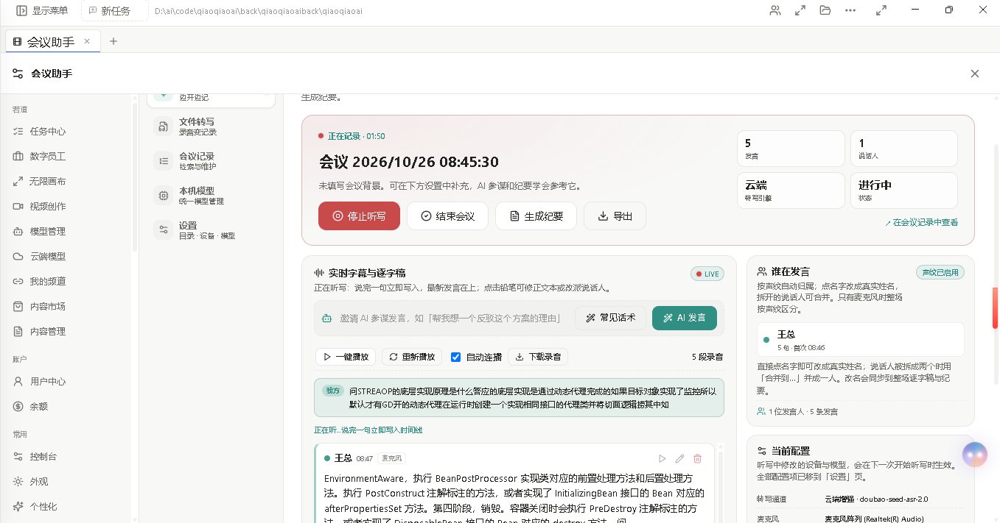
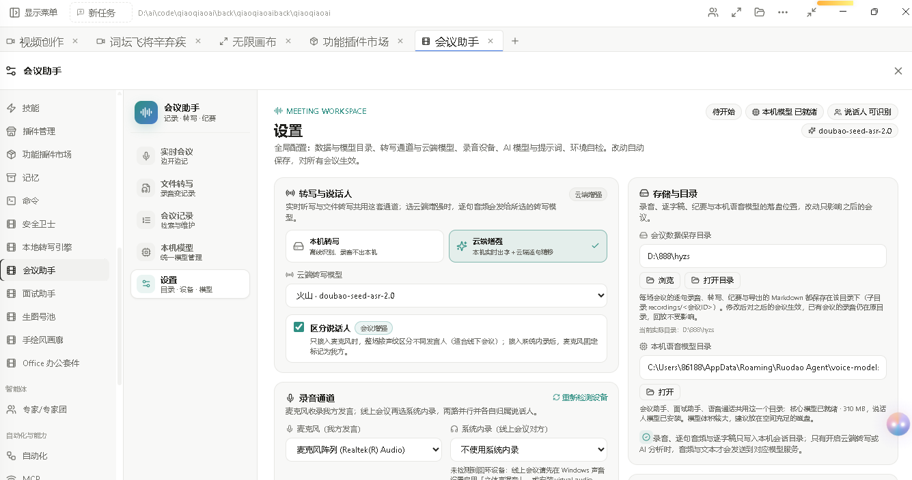
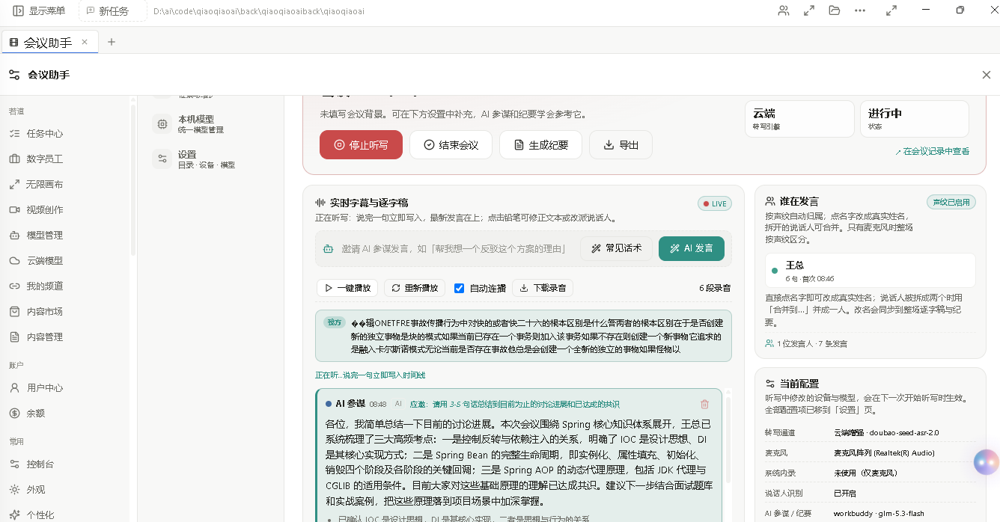
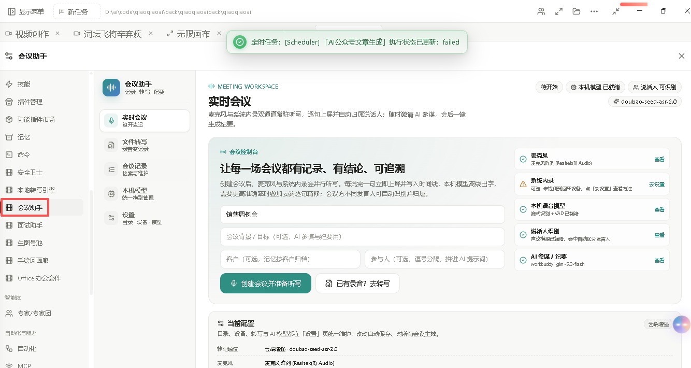
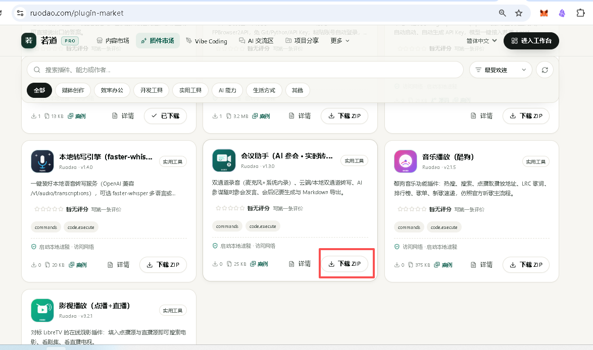
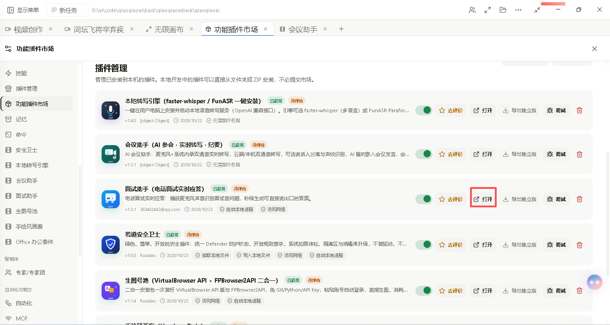

# 会议助手（AI 真正参会 · 录音不出本机 · 开源可改）

> **每一场会议，都值得一个 AI 队友。**
> 会议是企业里每天发生、最烧时间、最留不下资产的活动——说了一小时，没人记录；有了记录，没人回看；回看了，找不到结论。若道会议助手把这三件事一次解决：**实时转写、AI 参会讨论、一键纪要**，并且**录音和逐字稿全程不出你的电脑**。

[](https://ruodao.com/plugin-market/items/meeting-assistant)
[](LICENSE)
[](https://ruodao.com/plugin-market/items/meeting-assistant)

**📦 一键安装**：https://ruodao.com/plugin-market/items/meeting-assistant
（若道桌面端「功能插件市场」搜索"会议助手"，或市场页直接「下载 ZIP」。）

---

## 💎 五个让企业心动的理由

### 🔒 1. 录音全在本地，商业机密不出门
会议里谈的是报价、客户、融资、裁员……这些内容凭什么要传到别人的云上？
若道会议助手的识别引擎（sherpa-onnx）**离线运行在本机**，录音、逐句音频、逐字稿、纪要全部只写入你自己设定的本地目录。**不开启云端增强，就没有任何一个字节离开你的电脑**；就算开启，也只发给你自己配置的模型服务。审计、合规、保密协议，都好交代。

### 🤖 2. AI 不是"总结工具"，是真正参会讨论
市面上的"AI 会议纪要"都是事后诸葛：会开完了才给你一份冷冰冰的摘要。
若道会议助手的 AI 是**坐在会议桌旁的队员**——它实时听着全场上下文，你一句话（"AI，你怎么看这个方案？"）或一键点击，它就**当场在时间线里发言**：补充被忽略的角度、指出方案风险、给出数据参考。它还懂会议礼仪：有推荐话术，知道什么时候该说话、什么时候闭嘴。**让 AI 从"会议记录员"升级为"参会顾问"。**

### 🧑‍💼 3. 双通道 + 声纹，谁说了什么，一条不乱
线上会议：麦克风 + 系统内录双通道并行，对方和你分轨识别，天然不混淆。
线下会议：内置声纹模型自动区分不同发言人，"谁在发言"面板实时归属；识别错了可以改名、合并，**越用越准**。说完一句立即上屏，本机流式模型边说边出字，全程 0 等待。

### 🧬 4. 代码 100% 开源，功能不满足？让若道 Agent 当场改
这是和其他"黑盒会议软件"最本质的区别——**本仓库就是插件的完整源码**，免编译、即改即用：
- 想把纪要自动推到企业微信？想按你们公司的模板出周报？想接入自己的知识库做智能问答？
- **不需要给厂商提需求、等排期**。在若道桌面端里直接对 Agent 说一句"帮我把会议助手的纪要导出改成公司模板"，它会读懂本仓库的源码、改好代码、本地安装验证——**即时生效**。
- 你自己的团队改也行：纯 Node.js 脚本 + JSON 清单，半天就能上手（见下方二次开发指南）。

**你的会议流程，不该被软件的功能列表框死。**

### ⚡ 5. 精确解决企业实际问题，而不是"通用大而全"
| 企业的真实痛点 | 会议助手的解法 |
| --- | --- |
| 跨部门周会开完没人记得结论 | 实时逐字稿 + 一键纪要，结论自动沉淀为 Markdown 资产 |
| 客户沟通要留痕，但录音外传违规 | 本地录音 + 本地识别，数据主权 100% 在企业手里 |
| 会中临时要数据/要观点，没人接得住 | AI 参会随叫随到，基于全场上下文当场作答 |
| 线上线下会议流程不一样 | 双通道（线上）/ 声纹（线下）两套方案自由切换 |
| 采购的会议软件永远差一个功能 | 开源 + 若道 Agent 二次开发，缺什么补什么，即时生效 |

## 🖼️ 界面预览

| 实时会议（AI 参会中） | 设置（转写通道 / 说话人 / 存储目录） |
| --- | --- |
|  |  |

| 字幕逐字稿 + AI 发言 | 说话人自动识别 |
| --- | --- |
|  |  |

| 插件市场 | 插件管理 |
| --- | --- |
|  |  |

## ✨ 功能总览

| 功能 | 说明 |
| --- | --- |
| 🎙️ **实时会议转写** | 麦克风 + 系统内录双通道并行听写，每说一句立即上屏写入时间线，本机流式模型边说边出字 |
| 🧑‍💼 **说话人自动识别** | 内置声纹模型，不同发言人自动归属（可改名、可合并）；只有麦克风也能区分 |
| ☁️ **云端精转写（可选）** | 本机实时出字 + 云端逐句精修（豆包 seed-asr / GLM-ASR / Whisper 等 OpenAI 兼容服务），同音字自动修正；不配置也能纯本机离线跑 |
| 🤖 **AI 参会发言** | AI 实时听全场，口头或一键邀请即当场发言；推荐话术、会议礼仪内置 |
| 📝 **一键会议纪要** | 会中/会后按整场逐字稿生成结构化纪要 |
| 📂 **文件转写** | 已有录音/视频转记录：wav/mp3/m4a/aac/flac/ogg/wma/mp4/mkv/mov/webm，单文件上限 500MB，可选说话人分离 |
| 💾 **导出与回放** | 逐句录音、逐字稿、纪要一键导出 Markdown；任意一句可回放、编辑、删除 |
| 🔧 **环境自检** | ffmpeg、录音设备、STT/LLM 模型一键体检，缺什么补什么 |

## 📥 安装

1. 下载并安装 [若道桌面端](https://ruodao.com)。
2. 「功能插件市场」→ 搜索 **会议助手** → 安装；或从 [Releases](../../releases) / 市场页下载 ZIP，用「**从本地安装**」导入（不需登录）。
3. 打开插件点「环境自检」：按提示安装 FFmpeg、下载本机转写模型（约 20MB，支持断点续传）。
4. （可选）「模型管理」添加云端转写模型（如 `doubao-seed-asr-2.0`、`glm-asr`、`whisper-1`），在「设置 → 转写与说话人」选择"云端增强"。

## 🚀 使用教程

### 实时会议（线上会议 / 线下会议室都适用）

1. **创建会议**：填写主题、参会人（可选），点「创建会议并准备听写」。
2. **选录音通道**：
   - 线上会议：勾"使用系统内录"听会议对方声音，麦克风听你自己，两路并行、自动归属；
   - 线下会议：只用麦克风即可，声纹模型自动区分发言人。
3. **开始听写**：每说完一句立即上屏并写入时间线；配了云端精转写会逐句自动修正错别字。
4. **AI 参会**：点「AI 发言」或直接说"AI，你怎么看这个方案？"，AI 当场基于全场上下文发言；也能一键催它、点推荐话术。
5. **会中/会后**：任意一句可回放录音、改文本；「生成纪要」出结构化纪要；「导出」得 Markdown（含逐字稿与纪要），存在你设置的会议数据目录。

### 文件转写

已有录音/视频拖进「文件转写」→ 选本机或云端引擎、是否分离说话人 → 自动生成会议记录，同样可生成纪要、导出 Markdown。

### 设置建议

| 场景 | 推荐配置 |
| --- | --- |
| 涉密会议 / 合规要求 | 保持「本机转写」，不开云端，数据零出网 |
| 追求准确率 | 转写通道选「云端增强」，模型选豆包 seed-asr / GLM-ASR |
| 多人线下会议 | 打开「区分说话人」（首次引导安装声纹模型，约 34MB） |
| 低配机器 | 关闭双通道，仅麦克风 + 声纹区分 |

## 🛠️ 二次开发：改代码，即时生效

本插件**免编译**：源码即运行包，改完就能跑。

```
├── plugin.json           # 元信息：名称、版本、UI 入口
├── ruodao-plugin.json    # 核心：id、权限（process/network）、18 个命令声明
├── ui.json               # 插件界面配置
├── bin/meeting-assistant.mjs  # 全部业务逻辑（纯 Node.js，~1200 行）
├── test/plugin.test.mjs  # 测试
└── docs/screenshots/     # 本页截图
```

**两条路：**

- 🤖 **让若道 Agent 帮你改（推荐，人人可用）**：在若道桌面端里直接说需求，比如"把会议纪要导出改成我们公司的模板"、"加一个会前 10 分钟自动拉取昨日待办"。Agent 会读源码、改代码、本地安装、当场验证——**功能即时生效，不等版本发布**。
- 👨‍💻 **自己动手改**：① 在 `bin/meeting-assistant.mjs` 加子命令（读参数、干活、输出 JSON）；② 在 `ruodao-plugin.json` 的 `contributes.commands` 注册命令；③ 市场页「插件管理 → 从本地安装」选文件夹或 ZIP 验证（不需登录）。开发期可直接改已安装目录 `~/.codex/plugins/codex-market/meeting-assistant/` 再重启应用，热迭代。

运行测试：

```bash
node test/plugin.test.mjs
```

两点注意：

- **不要硬编码 API Key**。宿主提供模型凭据注入（`modelBinding`），走官方机制才安全。
- 想上架自己的改版？市场页「插件创作」提交 ZIP 审核即可，本仓库代码就是起点。

## 🔗 相关

- 插件市场页：https://ruodao.com/plugin-market/items/meeting-assistant
- 若道官网：https://ruodao.com
- 更多插件源码：https://github.com/ruodaoai

## License

MIT
